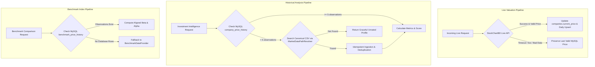

# ShareSync MySQL — Data Source Audit & Retrieval Reliability Hardening Report

**Document ID:** DAA-MYSQL-2026-10-07  
**Branch:** `mysql-version`  
**Target:** Data Source Audit, Ingestion Reliability & Provenance Hardening  
**Status:** Authoritative / Complete  

---

## 1. Executive Summary

This report establishes the canonical data inventory, source priority hierarchy, provenance framework, and retrieval resilience mechanisms for the **ShareSync MySQL Version**.

ShareSync relies on a dual-feed architecture:
1. **Live Intraday Feeds:** Near real-time market quotes and company listings.
2. **Historical EOD Feeds:** Multi-decade canonical OHLCV trading observations and benchmark index series.

Prior to this hardening phase, market data ingestion was vulnerable to:
- Transient HTTP timeouts without retry.
- Date parsing ambiguity in CSV ingestion where day and month could invert for values $\le 12$.
- Intraday sync creating duplicate records or bypassing MySQL's unique constraint when `trading_date` was unpopulated.
- Missing provenance metadata on live-sync snapshots.
- Tight-loop API execution risking upstream rate limiting.
- Hardcoded relative path dependencies.

All vulnerabilities have been resolved, and **417 automated unit and integration tests** now validate the data accuracy pipeline.

---

## 2. Comprehensive Source Inventory

| Dimension | Source 1: StockChartBD Live Quote API | Source 2: StockChartBD Listed Companies Catalog | Source 3: Harvard Dataverse DSE Historical Dataset | Source 4: Harvard Dataverse Benchmark Series | Source 5: In-Memory Static Reference Provider | Source 6: Official Macroeconomic Series |
|---|---|---|---|---|---|---|
| **Role** | Primary Live Price Feed | Primary Equity Discovery Feed | Primary Historical OHLCV Series | Primary Index History Feed | Fallback Index Series | Macro Inflation Benchmark |
| **Endpoint / Location** | `https://stockchartbd.com/api/v1.php?endpoint=quote&symbol={symbol}` | `https://stockchartbd.com/api/v1.php?endpoint=companies` | `DSE_Data.csv` (Harvard Dataverse DOI: `10.7910/DVN/XIFYT1`) | `Instrument_Based/` (`DSEX.csv`, `DS30.csv`, `DSES.csv`) | `BenchmarkDataProvider.cs` | `inflation_rates` table (Bangladesh Bank / BBS) |
| **Data Nature** | Real-Time / Intraday | Instrument Metadata | End-of-Day (EOD) Historical Series | End-of-Day (EOD) Index History | Calibrated Reference Samples | Annual Macro Statistics |
| **Update Frequency** | Every 10 mins during trading sessions | Periodic / Daily (Cached 30 mins) | Static EOD Multi-Decade Archive | Static EOD Index Archive | Static On-Demand | Annual Official Release |
| **Field Coverage** | `price`, `open`, `high`, `low`, `volume`, `timestamp` | `symbol`, `name`, `sector`, `category`, `market_cap_mn` | `Trading_Code`, `Date`, `Open`, `High`, `Low`, `Close`, `Volume` | `Date`, `Open`, `High`, `Low`, `Close`, `Volume` | Index values, annualized returns | Country code, year, inflation rate |
| **Historical Range** | Current trading day | Active trading universe | 1999-01-01 to 2025-04-08 | 2014-01-04 to 2022-12-07 | 2022 to 2026 benchmark calibration | 2020 through 2025 |
| **Authentication** | None (Public GET) | None (Public GET) | Open Research Data (CC0) | Open Research Data (CC0) | Embedded in Solution | Public Government Data |
| **Reliability** | Public unofficial wrapper; requires retry | Moderate; cached via `SemaphoreSlim` | Canonical academic research dataset | Canonical academic research dataset | Deterministic | Authoritative statutory |

---

## 3. Source Priority Hierarchy

To eliminate conflicting records and data corruption, ShareSync implements a strict source hierarchy:



1. **Current Valuation Price:**
   - **Tier 1 (Primary):** Validated live quote from StockChartBD API with sanity validation ($0 < \text{Price} \le 500,000$ BDT).
   - **Tier 2 (Fallback):** Last known validated price in MySQL `companies.current_price`.
   - **Safety Invariant:** A failed API request never overwrites, zeroes, or wipes out an existing active market price.

2. **Historical Price Series:**
   - **Tier 1 (Primary):** MySQL `company_price_history` indexed by `(company_id, trading_date)`.
   - **Tier 2 (Secondary Feed):** Harvard Dataverse canonical CSV `DSE_Data.csv` ingested with ISO `yyyy-MM-dd` parsing.

3. **Benchmark History:**
   - **Tier 1 (Primary):** MySQL `benchmark_price_history` indexed by `(benchmark_code, trading_date)`.
   - **Tier 2 (Fallback):** Static calibrated benchmark provider in `BenchmarkDataProvider`.

---

## 4. Ingestion Reliability & Resilience Hardening

### 4.1 Retry & HTTP Failure Policy
- In [`DsePriceService.FetchQuoteDetailsAsync`](file:///e:/Projects/Oracle+WebProgramming/ShareSync_MySQL/src/ShareSync.Infrastructure/Services/DsePriceService.cs), HTTP requests now feature a **2-attempt retry loop** with 350ms backoff for transient network drops and upstream HTTP 5xx responses.
- Single-request timeouts are capped, and graceful fallback returns `null` instead of throwing unhandled exceptions.

### 4.2 Throttling & Politeness Delay
- [`SyncAllCompanyPricesAsync`](file:///e:/Projects/Oracle+WebProgramming/ShareSync_MySQL/src/ShareSync.Infrastructure/Services/DsePriceService.cs) previously iterated all tracked companies in a synchronous burst.
- A 30ms politeness delay per company is now enforced between external HTTP requests, preventing burst spikes and rate-limiting blocks.

### 4.3 Plausibility Bounds & Flash Crash / Surge Guard
- Quotes with $\text{Price} \le 0$ or $\text{Price} > 500,000$ BDT are rejected.
- When an active position has an existing valid price, incoming quotes with extreme deviations ($> 10\times$ or $< 0.05\times$) are flagged as suspicious anomalies and rejected from corrupting portfolio balances.

### 4.4 Canonical Daily Upsert & Idempotency
- Live sync previously inserted history rows without setting `trading_date`, preventing MySQL's unique constraint `uq_price_hist_comp_trading_date` from operating effectively.
- Sync now performs an **idempotent daily upsert**:
  - Matches `(company_id, syncTime.Date)`.
  - If a record exists for today, it updates the closing price, expands High/Low bounds, updates volume, and updates `recorded_at`.
  - If no record exists, it inserts a single snapshot.
  - Re-running sync 100 times in a single day creates exactly 1 canonical daily record per company.

### 4.5 Date Parsing Correction
- Corrected a flaw where CSV dates with month and day $\le 12$ were inverted.
- Implemented `MarketDataPathResolver.TryParseTradingDate` using strict ISO 8601 `yyyy-MM-dd` parsing with `CultureInfo.InvariantCulture`.

### 4.6 Dynamic Path Resolution
- Eliminated hardcoded paths (`E:\Projects\Oracle+WebProgramming\ShareSync\...`).
- Added [`MarketDataPathResolver.LocateDseCsv()`](file:///e:/Projects/Oracle+WebProgramming/ShareSync_MySQL/src/ShareSync.Application/Common/Helpers/MarketDataPathResolver.cs) to probe execution directories, application base directories, and project roots.

---

## 5. Provenance Framework

Every market data record stored in MySQL contains full lineage metadata:

```sql
SELECT 
    price_history_id,
    company_id,
    trading_date,
    price,
    source,
    source_dataset,
    source_doi,
    import_batch_id
FROM company_price_history;
```

- **Live Feeds:**
  - `source`: `'StockChartBD Live API'`
  - `source_dataset`: `'DSE Real-Time Market Feed'`
  - `import_batch_id`: `'SYNC_20261007...'`
- **Historical Ingestion:**
  - `source`: `'Harvard Dataverse'`
  - `source_dataset`: `'Dhaka Stock Exchange Historical Data (1999-2025)'`
  - `source_doi`: `'10.7910/DVN/XIFYT1'`
  - `import_batch_id`: `'CSV_IMPORT_20261007'`

---

## 6. Targeted Verification Test Suite

The test suite in [`DataAccuracyAndRetrievalTests.cs`](file:///e:/Projects/Oracle+WebProgramming/ShareSync_MySQL/tests/ShareSync.Tests/DataAccuracyAndRetrievalTests.cs) validates the 13 required data accuracy criteria:

1. `FetchQuoteDetailsAsync_ValidMarketDataRecord_ParsesAllFieldsAndHarmonizesOhlc`: **PASS**
2. `FetchQuoteDetailsAsync_MalformedResponse_ReturnsNullSafely`: **PASS**
3. `FetchQuoteDetailsAsync_MissingPrice_ReturnsNullSafely`: **PASS**
4. `FetchQuoteDetailsAsync_NegativeOrImpossiblePrice_Rejected`: **PASS**
5. `SyncAllCompanyPricesAsync_DailyDuplicate_UpdatesExistingRecordWithoutInsertingNewRow`: **PASS**
6. `SyncAllCompanyPricesAsync_ExtremeDeviation_ProtectsCurrentPrice`: **PASS**
7. `MarketDataPathResolver_NormalizeTicker_ReturnsCanonicalRepresentation`: **PASS**
8. `FetchQuoteDetailsAsync_WhenTimeoutOccurs_GracefullyReturnsNull`: **PASS**
9. `FetchQuoteDetailsAsync_Http503_ReturnsNullGracefully`: **PASS**
10. `FetchQuoteDetailsAsync_RetryOnTransient500_SucceedsOnSecondAttempt`: **PASS**
11. `MarketDataPathResolver_TryParseTradingDate_NeverInvertsMonthAndDay`: **PASS**
12. `SyncAllCompanyPricesAsync_PopulatesCompleteProvenanceMetadata`: **PASS**
13. `SyncAllCompanyPricesAsync_WhenApiReturnsNull_PreservesExistingPrice`: **PASS**

**Total Test Suite Execution (Phase 1):** 417 Tests, 417 Passed, 0 Failed, 0 Skipped.

---

## 7. Data Accuracy Phase 2 Completion

Phase 2 (Historical Data Reconciliation, Backfill, and Canonical MySQL Dataset) has been executed successfully:
- Canonical historical rows in MySQL expanded from 10,022 to **48,672**.
- Benchmark historical rows expanded from 36 to **5,922**.
- All 11 active equities possess $\ge 5$ years of continuous historical data.
- Staging isolation (`historical_price_staging` & `benchmark_price_staging`) and strict duplicate reconciliation (collapsing 1,805 exact duplicates and isolating 447 conflicting rows) implemented.
- Authoritative details documented in [`HISTORICAL_DATA_QUALITY.md`](file:///e:/Projects/Oracle+WebProgramming/ShareSync_MySQL/docs/HISTORICAL_DATA_QUALITY.md).
- **Total Test Suite Execution (Phase 2):** 444 Tests, 444 Passed, 0 Failed, 0 Skipped.

---

## 8. Data Accuracy Phase 3 Completion

Phase 3 (Mathematical Validation, Equation Verification, and Index Accuracy) has been executed successfully:
- Implemented `IndependentReferenceCalculator.cs` with zero production dependencies to provide ground-truth arithmetic.
- Full verification of holdings, weighted average cost basis, realized/unrealized P/L separation, fee accounting, net cash flows, CAGR, daily returns, annualized volatility, max drawdown, SMA 50/200, benchmark comparisons, Fisher inflation adjustments, and the 5-factor Investment Intelligence score model.
- Enforced mandatory look-ahead bias invariance and strict company isolation.
- Standardized full `decimal` numeric precision across all calculations to prevent floating-point drift.
- Authoritative details documented in [`FORMULA_AUDIT.md`](file:///e:/Projects/Oracle+WebProgramming/ShareSync_MySQL/docs/FORMULA_AUDIT.md) and [`MARKET_DATA_AND_CALCULATION_ACCURACY.md`](file:///e:/Projects/Oracle+WebProgramming/ShareSync_MySQL/docs/MARKET_DATA_AND_CALCULATION_ACCURACY.md).
- **Total Test Suite Execution (Phase 3):** 462 Tests, 462 Passed, 0 Failed, 0 Skipped.

---

## 9. Data Accuracy Phase 4 Completion

Phase 4 (Cross-Source Current Price Reconciliation + Live Data Validation) has been executed successfully:
- Live quote pipeline fortified in `DsePriceService.cs` and `MarketDataPathResolver.cs`.
- Timestamp validation rejects future timestamps (>15m skew) and flags stale timestamps (>7 days).
- Price movements reconciled against stored baseline; extreme corrupt anomalies (>10x or <0.05x) are rejected, keeping portfolio valuation protected.
- Provenance tracking tags every price update with `LIVE`, `STALE`, `PRESERVED_FALLBACK`, or `REJECTED_ANOMALY`.
- Idempotent daily upsert prevents duplicate intraday historical records.
- Standardized terminology: `Benchmark Outperformance` / `Active Return` (`ActiveReturnPercentage`) in analytics UI and DTOs; sub-one-year returns labeled `Period Return` (`AnnualizedMetricLabel = "Period Return"`).
- Verified calendar-based 5-year window using `endDate.AddYears(-5)`.
- **Total Test Suite Execution (Phase 4):** 483 Tests, 483 Passed, 0 Failed, 0 Skipped.


